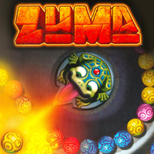

<h1 align=center>zuma-nx installer</h1>

The installer page of [zuma-nx](https://github.com/ChanseyIsTheBest/zuma-nx), the native Nintendo Switch
port of Zuma (Xbox Live Arcade): **https://chanseyisthebest.github.io/zuma-nx-installer/**

You give it your own copy of the game and its Title Update #2, and it gives you a zip ready to extract into
`sdmc:/switch/`. Everything runs in
your browser: the game files never leave your computer.

## What it does

1. **Finds your files** in what you chose (files or a whole folder):
   - the game: its content package `90226B760A840A3AFC759094668DA3FBE4DF716D58` (title `584107EF`, content type
     `0x000D0000`, read in place: `lib/from_sa2/stfs_package.js`), or a folder it was extracted into (`default.xex`
     with `resources/resources.xpr`);
   - Title Update #2: its package (content type `0x000B0000`, `TU_1C421VF_0000104000000.00000000000O1`), or its
     `default.xexp` (on its own or beside the game's `default.xex`). It is needed: the port's code is the updated
     executable, which the console makes from `default.xex` and `default.xexp` when the game starts, as the Xbox does.
   Zuma has no add-on.
2. **Checks them** against `release/manifest.json`: `default.xex` and `default.xexp` by their SHA-256, the game's other
   files by their sizes.
3. **Downloads the build's NRO** and checks its SHA-256.
4. **Writes the game pack** (`game_root.nxpack` + `.nxidx`, `lib/nxpack.js`) from the game's files, its folders
   included, and the title update's `default.xexp`.
5. **Streams the zip to disk** through the service worker, so nothing large has to fit in memory.

The game compiles all of its 7 shaders while it runs, with the Xbox's shader compiler, so none is stored in its
files and the page has no shaders to make: the NRO carries them.

The zip holds `zuma-nx/zuma.nro` with its `LICENSES.txt` and `game_root.nxpack` + `.nxidx`. The update zip
holds the NRO and its licenses. Neither holds `zuma.toml`: the game writes it at its first start, so an update never
overwrites your settings.

## Checks

- `test/manifest_node.mjs`: writes the build's entry of `release/manifest.json` from the tested files (the game, its
  title update and the NRO).
- `test/package_node.mjs`: the whole zip in Node with the page's code; its game pack is the native tool's
  (`tools/build_asset_pack.py` of zuma-nx) byte for byte apart from the pack's random id. That zip, extracted, was
  played in Ryujinx from a first start.
- `test/texts_node.mjs`: the interface texts.

## Layout

| Path | Contents |
|---|---|
| `index.html`, `app.js` | The page and its interface (`lib/i18n.js`) |
| `worker.js` | Builds the package off the main thread |
| `sw.js` | Offline cache and the download stream |
| `lib/` | STFS package reader, asset pack and zip writers |
| `release/` | The list of builds and the licenses of the NRO; the deployment adds the NRO from the zuma-nx release |
| `test/` | Node scripts that run the same code as the page |

## License

GPL-3.0 (see [LICENSE](LICENSE)). Third-party components are listed in [NOTICES.md](NOTICES.md). The page is built on
[feedingfrenzy-nx-installer](https://github.com/ChanseyIsTheBest/feedingfrenzy-nx-installer) (with the title update
found as [peggle1-nx-installer](https://github.com/ChanseyIsTheBest/peggle1-nx-installer) finds Peggle's), itself built
on [bejeweled3-nx-installer](https://github.com/ChanseyIsTheBest/bejeweled3-nx-installer),
[peggle1-nx-installer](https://github.com/ChanseyIsTheBest/peggle1-nx-installer),
[peggle2-nx-installer](https://github.com/ChanseyIsTheBest/peggle2-nx-installer),
[futari-nx-installer](https://github.com/ChanseyIsTheBest/futari-nx-installer),
[sa2-nx-installer](https://github.com/ChanseyIsTheBest/sa2-nx-installer) and
[nfsmw-nx-installer](https://github.com/StevensND/nfsmw-nx-installer) by StevensND.

Zuma is a trademark of PopCap Games / Electronic Arts; the icon artwork is © PopCap Games. This project is not
affiliated with or endorsed by PopCap Games, Oberon Media, Electronic Arts, Nintendo or Microsoft.
